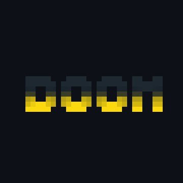

# Hi, I'm Mathias

I'm bad at writing but want to write blogposts anyways, I currently live near [Brest](https://www.google.com/maps/search/Brest).
I'm also an hackclubber () and member of [LPH](https://wiki.mdl29.net/doku.php?id=start).

Here's some projects I'm proud of: 

> ## Wall Breakers
> 
>
> Website to break paywalls from various news site like Le Monde, Médiapart, Washington Post, Ouest France and more
> 
> [GitHub](https://github.com/MathiasDPX/wall-breakers) [Demo](https://news.mathiasd.fr/)
{: type="project" style="border-left-color: #ececec"}

> ## ArchiveTube
> 
>
> yt-dlp frontend for full YouTube archive. Archive the thumbnail, description, subtitles and everything; with OIDC support, Prometheus exporter
> 
> [GitHub](https://github.com/MathiasDPX/archivetube) [Demo](https://yt.mathiasd.fr/)
{: type="project" style="border-left-color: #FF0033"}

> ## jekyll-hackclub
> 
>
> Jekyll plugin to mention Slack users or channels. You can also query users.info api endpoints to retrieve raw informations like userid or avatar. It also add an Slack emoji resolver
> 
> [GitHub](https://github.com/MathiasDPX/jekyll-hackclub) [Demo](https://mathiasdpx.github.io/jekyll-hackclub/) [Gem](https://rubygems.org/gems/jekyll-hackclub)
{: type="project" style="border-left-color: #ED3850"}

> ## GH-DOOM
> 
>
> Play DOOM64 through GitHub contributions graph. It take a screenshot of the game, resize it and display it on the graph through Selenium and repeat as fast as possible
> 
> [GitHub](https://github.com/GH-DOOM/DOOM64) [Demo video](https://www.youtube.com/watch?v=OPmpIwJ8uDY)
{: type="project" style="border-left-color: #FFDF0D"}

> ## CinéBrest
> 
>
> A platform that group all Brest cinema schedules on one page, offering real-time updates and a user-friendly design for effortless movie planning.
> Forked and heavily optimized from [grainParisArt](https://github.com/solene-drnx/grainParisArt-Public)
>
> [GitHub](https://github.com/MathiasDPX/grainParisArt/tree/brest) [Demo](https://cinema.mathiasd.fr/)
{: type="project" style="border-left-color: "#444CF7"}

> ## Babarcode
> 
>
> Play Minecraft with a barcode reader, it read input sent by the reader and press the associated keys from a dictionnary. It is survival-friendly by having toggle keys for eating and breaking blocks however you need the mouse to move the camera around
>
> [GitHub](https://github.com/MathiasDPX/Babarcode) [Demo video](https://www.youtube.com/watch?v=cZzIax472Eg)
{: type="project" style="border-left-color: #4DAB61"}